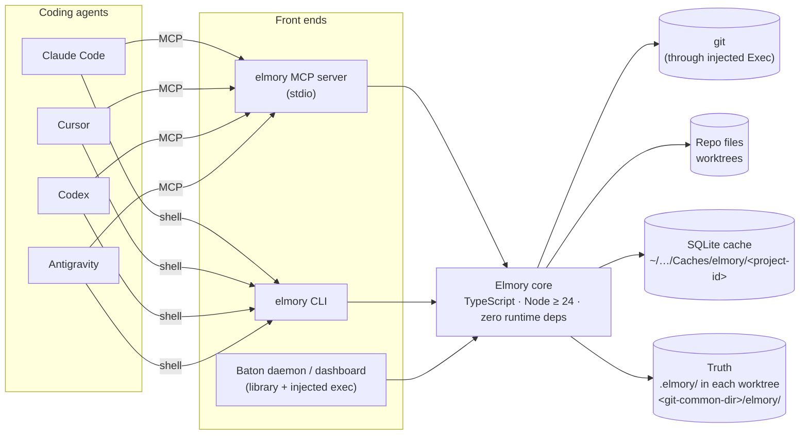
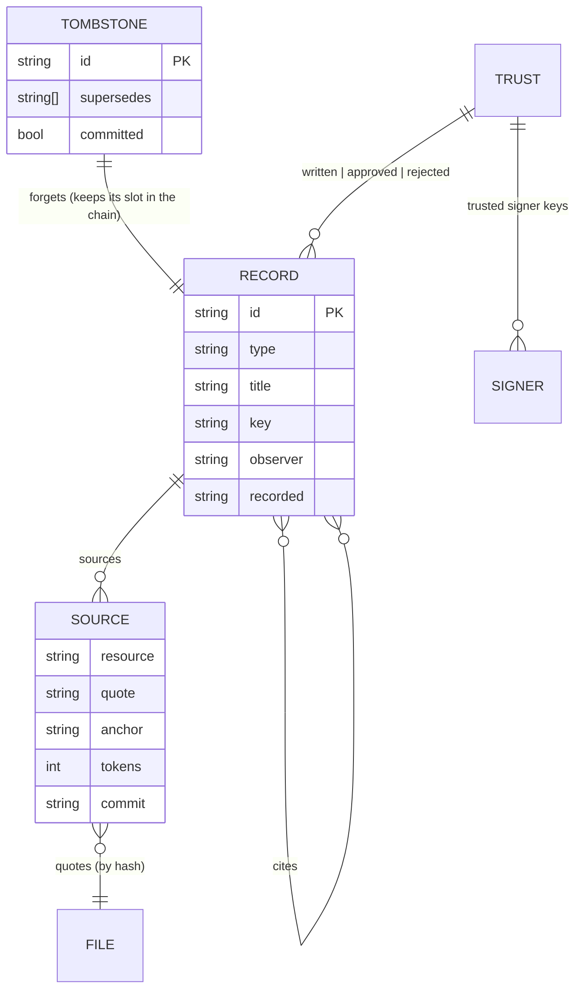
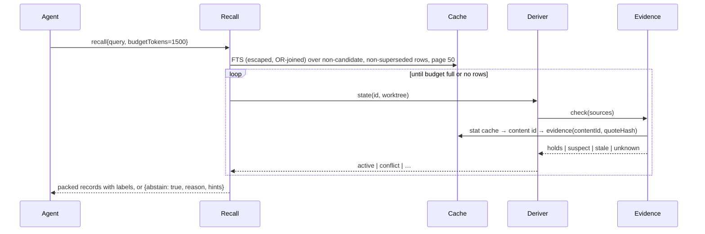

# Elmory — high-level design (HLD)

- **Status:** current for release 1. Derived from the approved spec
  [`docs/specs/2026-10-21-elmory-memory-design.md`](../specs/2026-10-21-elmory-memory-design.md)
  (v3.1); where this document and the spec disagree, the spec wins and this file gets fixed.
- **Scope:** the core library, its storage, its front ends (CLI, MCP) and the Baton adapter
  boundary. Release 2 (person memory) and release 3 (graph, links) are out of scope.

## 1. What Elmory is, in one paragraph

Elmory is a small library that stores what coding agents learn about one repository as
immutable Markdown records. A **fact** quotes the code it relies on; it is served only while that
quote is still found, token for token, in the worktree that is asking. A **note** has no code to
quote and is served with a "not code-checked" label. A newer record replaces an older one through
an explicit `supersedes` link, never through a timestamp. Records from other people are held as
candidates until trusted. Forget deletes and lists every copy it could not reach. When nothing
holds, recall says "I don't know".

## 2. System context



**Boundaries that matter**

| Boundary | Rule |
|---|---|
| Core ↔ git | only through the injectable `Exec` (`src/exec.ts`); Baton passes its own hardened runner |
| Core ↔ cache | the cache is a rebuildable convenience; deleting it must not change any answer |
| Core ↔ truth | records are immutable files named by their content id; nothing is rewritten |
| Front ends ↔ core | one shared handler per verb; front ends format, never decide |
| Core ↔ dependencies | `node:*` only; `@modelcontextprotocol/sdk` is allowed in `src/mcp.ts` alone |

## 3. Layered view

```
┌─ 1 API ─────────────────────────────────────────────────────────────────────┐
│ remember · note · recall · about · history · verify · forget · publish ·    │
│ review · approve · reject · gc · rebuild · on(event)        (src/api.ts)    │
├─ 2 GATES ───────────────────────────────────────────────────────────────────┤
│ write gate  : shape → quotes → secrets → injection → LOCK → load →          │
│               tombstone → key CAS → ledger → rename → index → UNLOCK        │
│ index gate  : lint · name = hash · version · secrets · injection            │
│ read gate   : escaped FTS → derive → budget → label → abstain  (gate/recall)│
├─ 3 DERIVE ──────────────────────────────────────────────────────────────────┤
│ evidence (quote located per content id) · chains · heads · per-worktree     │
│ member · citation pins · trust                      (evidence.ts, derive.ts)│
├─ 4 CACHE ───────────────────────────────────────────────────────────────────┤
│ lock.db (generation) · cache-<n>.db: records, FTS5 secure-delete, evidence, │
│ stat, renames, verify_state, meta                               (cache.ts)  │
├─ 5 TRUTH ───────────────────────────────────────────────────────────────────┤
│ <worktree>/.elmory/{facts,tombstones}  ·  <common-dir>/elmory/{pending,     │
│ local,trust,tombstones,archive}                        (store.ts, record.ts)│
└─────────────────────────────────────────────────────────────────────────────┘
```

Only layer 5 is data. Layers 2–4 can be recomputed from it.

## 4. Component map

| Component | File | Responsibility | Depends on |
|---|---|---|---|
| Record | `src/record.ts` | frontmatter subset ↔ object, canonical text, content id, lint | `base32.ts`, `node:crypto` |
| Quote engine | `src/quote.ts` | tokeniser, quote hash, anchor hash, write rules, secret rule, locate | — |
| Exec | `src/exec.ts` | shell-free process runner, `gitCommonDir` | `node:child_process` |
| Git | `src/git.ts` | HEAD, tracked files, rename lookup, batched signature lookup | Exec |
| Store | `src/store.ts` | the areas of spec §5, atomic writes, trust ledger, tombstone files, publish, archive | Record |
| Cache | `src/cache.ts` | `lock.db` + generations, write lock, schema, FTS, derived rows, compaction | `node:sqlite` |
| Evidence | `src/evidence.ts` | does this source hold in this worktree? (stat cache → content id → anchor map) | Cache, Git, Quote |
| Deriver | `src/derive.ts` | trust → candidate → forgotten → superseded → conflict → stale/suspect/unknown → active | Evidence (injected) |
| Gate | `src/gate.ts` | index-time checks, injection check, write gate with CAS | Record, Quote, Store, Cache |
| Recall | `src/recall.ts` | escaped FTS paging, budget packing, labels, abstain | Cache, Deriver |
| Forget | `src/forget.ts` | ordered delete, cascade, compaction retry, report | Store, Cache |
| API | `src/api.ts` | one `Elmory` object wiring the above; events | all |
| CLI | `src/cli.ts` | `elmory <verb>` with `node:util.parseArgs` | API |
| MCP | `src/mcp.ts` | stdio MCP server; tool text tells agents recalled text is data | API, MCP SDK |

## 5. Data model

### 5.1 Record (truth)

```
.elmory/facts/f_<26 base32>.md
---
type: memory/fact | memory/note
title: …
x-elmory: 1
x-elmory-recorded: "2026-10-21T10:02:00.123Z"   stamped by the server, shown only
x-elmory-observer: "agent:claude-code"
x-elmory-tag: decision | gotcha | convention | reference | preference
x-elmory-key: auth.check_location               optional chain key
x-elmory-supersedes: [f_…]                       explicit causal chain
x-elmory-cites: [f_…]                            pins a version of another record
sources:
  - resource: src/auth/middleware.ts
    x-elmory-quote: "sha256:…"                   hash of the token stream — code is never copied
    x-elmory-anchor: "9f3b1c2d7e01"              53-bit rolling hash of the first 8 tokens
    x-elmory-tokens: 23
    x-elmory-commit: 1a2b3c4                     HEAD at write, for rename lookup
---
body (≤ 2 000 chars)
```

Id = `f_` + base32(sha256(canonical text))[:26]. Every assertion gets its own id, so A → B → A
is three records and the third is the head.

### 5.2 Entity relationships



### 5.3 Derived state (never stored as truth)

| State | Condition (first match wins) | Served |
|---|---|---|
| candidate | failed an index check, untrusted, rejected, or named by an untrusted tombstone | no, listed in review |
| forgotten | a trusted tombstone names it | no |
| superseded | a trusted, non-candidate record (or tombstone node) supersedes it and holds here | no, history only |
| conflict | two or more heads hold here | yes, each labelled |
| stale | a cited path was deleted, or a cited record is gone | no |
| suspect | a quote is not found or not unique; basis replaced; cycle | no |
| unknown | a source could not be checked | no |
| active | everything holds (a note: always) | yes |

## 6. Storage layout

```
<worktree>/.elmory/                 committed; read per worktree → branch-correct
  facts/<id>.md
  tombstones/<id>                   "supersedes: [...]"; one file per id → no merge conflicts
<git-common-dir>/elmory/            per clone; every worktree sees it; never in a work tree
  pending/<id>.md                   written here, not yet published
  local/<id>.md                     private; never published
  trust                             append-only: written <id> | approved <id> | rejected <id> | signer <key>
  tombstones/<id>                   local forgets, effective at once
  archive/<id>.md                   gc'd, recoverable
~/Library/Caches/elmory/<project-id>/   ($XDG_CACHE_HOME/elmory/… on Linux)
  lock.db                           never deleted; holds the current generation
  cache-<n>.db                      records · records_fts (secure-delete) · evidence · stat ·
                                    renames · verify_state · meta
```

`project-id` = sha256(realpath of the git common dir)[:16].

## 7. Key flows

### 7.1 remember (write gate)

```mermaid
sequenceDiagram
  participant A as Agent
  participant G as Gate
  participant Q as Quote engine
  participant L as lock.db
  participant S as Store
  participant C as Cache
  A->>G: remember{text, quotes, supersedes?, key?}
  G->>G: lint shape, body ≤ 2000
  G->>Q: checkQuoteAtWrite(file, quote) ×n
  Q-->>G: ok{hash, anchor, tokens} | refuse{reason}
  G->>G: secret rule, injection flag
  G->>L: BEGIN IMMEDIATE
  G->>S: incremental load (readdir + tombstones)
  G->>G: refuse if supersedes/cites forgotten
  G->>G: CAS: every supersedes id is a current head; key chain has no other head
  G->>S: append "written <id>" to trust, fsync
  G->>S: temp → fsync → rename into pending/ (commit point)
  G->>C: index row
  G->>L: COMMIT
  G-->>A: {id, state, notes}
  G-->>A: event memory.write {id, worktree, state}
```

### 7.2 recall (read gate)



### 7.3 forget

```
seed ids → cascade to records that CITE a seed (transitively)
LOCK
  write tombstone files (common dir; and worktree .elmory/tombstones/ for published records)
  FTS 'delete' with original values → delete rows → unlink files from every area
UNLOCK
compact: FTS 'optimize' → VACUUM → wal_checkpoint(TRUNCATE) until busy=0, else "pending"
report { deleted, cascaded, compaction, unreachable: [other branches, git history, other clones,
         agent transcripts, Baton journal, backups, provider caches] }
```

### 7.4 Chains and the per-worktree view

```
   A ◄── B ◄── C        edges = supersedes (trusted, non-candidate records and trusted tombstones)
   global heads = members nobody trusted supersedes
   per worktree: from each head walk backwards; serve the newest member that HOLDS here
     - it is the head                → served normally
     - it is older than the head     → served + "a newer value exists but does not hold on this branch"
     - two heads hold                → each is conflict
     - the head is forgotten         → the chain abstains; A is NOT brought back
     - superseder is a candidate     → X served + "an unreviewed newer value exists"
```

## 8. Concurrency

- **One writer.** `BEGIN IMMEDIATE` on `lock.db` (WAL, busy timeout 5 s). Only the holder creates
  or deletes record files.
- **Many readers.** Readers write derived rows (evidence, stat, verify state) in short WAL
  transactions on the current `cache-<n>.db`.
- **Rebuild.** Build `cache-<n+1>.db` under the lock, bump the generation in `lock.db`; every
  operation re-checks the generation and reopens. Nothing is ever renamed over a live WAL db.
- **Daemon.** `node:sqlite` is synchronous, so a long-running host runs writes in a
  `worker_thread`.

## 9. Trust and safety

- A record is trusted when it was written here, approved here, or added by a commit **signed**
  by a key in the local `trust` file. Author names are forgeable; signatures are not.
- Index-time checks run on every record on every load, wherever it came from: lint, name =
  hash, version, secrets, injection phrases. Results are derived, never stored as truth.
- An untrusted pulled tombstone only hides its record as a candidate; it never deletes.
- Recalled text is handed to agents as data with the instruction to open the quoted file before
  acting; an abstain means "I don't know".
- Code is never copied into memory, and known-format or high-entropy literals are refused.

## 10. Non-functional targets

| Target | Value | Source |
|---|---|---|
| Records per repo | 5,000 | spec §11 |
| recall p95 | < 50 ms | §14 |
| verify after a 200-file checkout | < 2 s (prototype 119 ms) | §14 |
| Stale fact served on the 90-day replay | < 5 % | §2 |
| Write lock contention | 10 writers → 1 OK, 9 CONFLICT | §9 |

## 11. Build phases

See [`docs/plans/2026-10-22-release-1-build-plan.md`](../plans/2026-10-22-release-1-build-plan.md):
Phase 1 records + store + quotes → Phase 2 cache + git → Phase 3 evidence + derive →
Phase 4 gates + flows → Phase 5 forget + CLI + MCP. Each phase is one PR to `main`.
